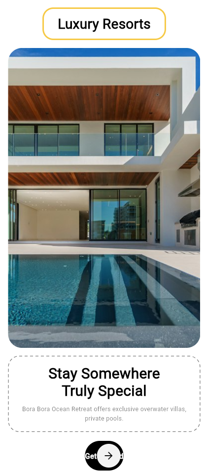
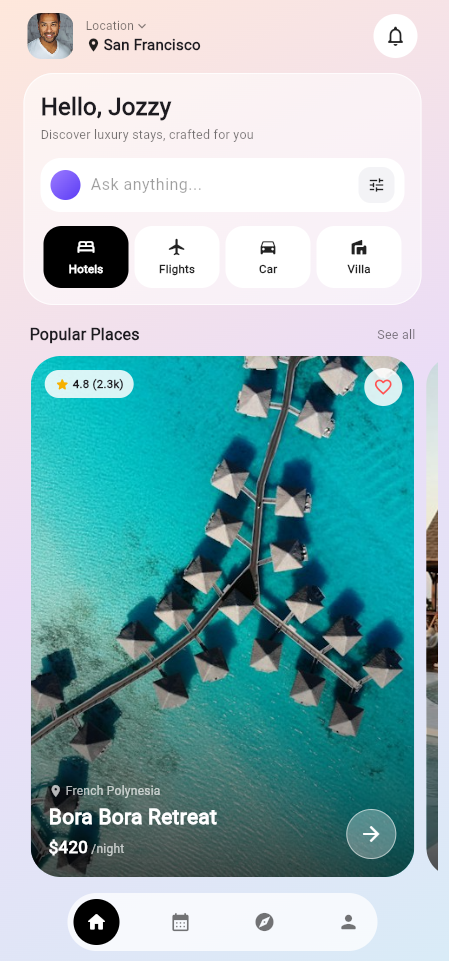
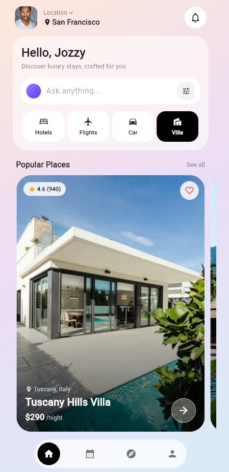

# Luxury Resorts

Luxury Resorts is a Flutter application for discovering luxury stays and travel services. The app presents a clean, modern interface that allows users to browse resorts, villas, and hotels with pricing, ratings, and location details.

## Screenshots

| Welcome Screen | Home - Hotels | Home - Villa |
| :---: | :---: | :---: |
|  |  |  |

## Features

- Welcome screen with a hero image, tagline, and a Get Started action.
- Home screen with a personalized greeting and location selector.
- Search bar with an integrated filter action.
- Service categories: Hotels, Flights, Car, and Villa, with a highlighted active state.
- Popular Places section listing properties horizontally.
- Property cards displaying rating, number of reviews, location, name, and nightly price.
- Favorite button on each property card.
- Bottom navigation bar with Home, Calendar, Compass, and Profile tabs.

## Getting Started

Prerequisites: Flutter SDK installed and configured.

1. Clone or download the project, then navigate to the project directory:

```bash
cd luxury_resorts
```

2. Install the dependencies:

```bash
flutter pub get
```

3. Run the application on a connected device or emulator:

```bash
flutter run
```

## Project Structure

```
lib/
├── main.dart                # Application entry point
├── app_common.dart          # Shared colors and reusable widgets
├── welcome_screen.dart      # Welcome / onboarding screen
└── home_screen.dart         # Home screen with categories and property listings
```

## Technology

- Flutter with Material 3
- Network images with loading and error handling
- Custom page transitions using PageRouteBuilder
- Stateful widgets for managing category selection and navigation state

## Future Enhancements

- Property detail page
- Favorites persisted locally
- Booking flow with date selection
- User authentication
- Localization support

## License

This project is provided for educational and demonstration purposes.
